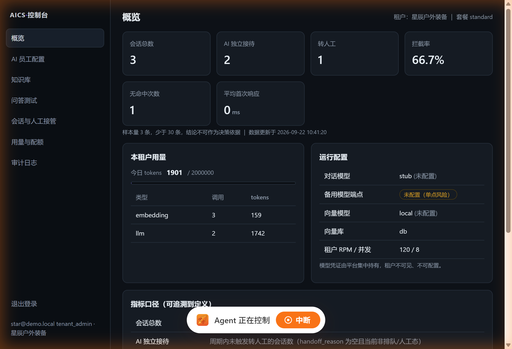
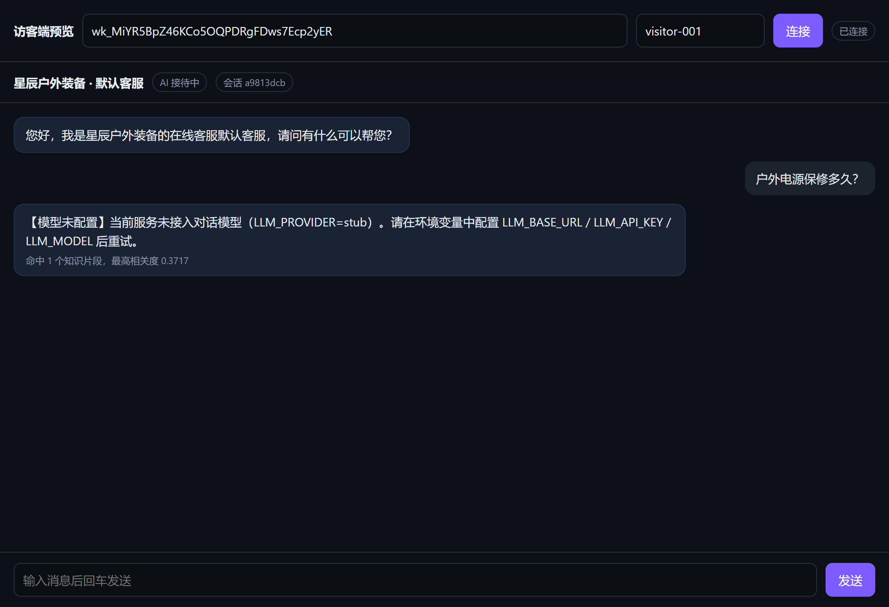

# AICS · 多租户 AI 客服系统

一套**可运行**的多租户 AI 客服系统实现，用于替代人工客服。同一套服务同时服务多个租户，
租户之间的数据、知识库、会话、额度彼此隔离。

**当前状态**（2026-10-18 核对自 `.env` 与代码实况）：

- 后端：FastAPI + SQLAlchemy 2.0 + Pydantic v2；数据库 PostgreSQL（开发连自建 PG，
  不配 `DATABASE_URL` 时回落 SQLite，零外部依赖也能跑通链路）
- 前端：内置管理控制台（`/admin`）+ 访客对话挂件（`/widget`），纯静态、无构建步骤
- 对话模型：deepseek 双档 —— 主档 `deepseek-flash`（官方 API），开发档
  `deepseek-v4.1-flash`（pateway 中转，供自动化测试省钱，按请求头切换）
- 向量模型：Gitee AI `bge-m3`（1024 维）；重排 `Qwen3-Reranker-8B`（两阶段检索第二级）；
  视觉转写 `Qwen3-VL-30B-A3B-Instruct`（扫描版 PDF / 聊天图片）
- 向量库：Qdrant（**自建集群**；原 Qdrant Cloud `sa-east-1` 集群从国内被定向阻断，已迁移）
- RAG：LlamaIndex 0.14 引擎为默认（`RAG_ENGINE=llama`），旧引擎 `legacy` 可随时切回对比
- 测试：**458 项 pytest**（25 个文件，随仓库分发）；47 条人工回归基线
  （LLM 裁判：32 pass / 9 partial / 6 fail）
- 扩展能力：访客链接内容提取（webfetch + Fetch MCP）、扫描件 OCR 兜底、
  全链路分阶段耗时日志、PG 自动补列

---

## 1. 快速开始

### 1.1 环境准备

```bash
cd aics
python -m pip install -r requirements.txt
```

> **本机现实**：开发机依赖装在
> `C:/Users/Administrator/.workbuddy/binaries/python/envs/default`（`Scripts/python.exe`），
> 项目目录内没有 venv；系统 Python 3.12 与托管版 3.13 均未装依赖，别用错解释器。
> 新克隆环境按上面命令安装（`psycopg` / llama-index / qdrant-client 按需，见清单注释）。

### 1.2 启动

```bash
python run.py        # uvicorn app.main:app，127.0.0.1:8000，WatchFiles reload
```

`HOST` / `PORT` / `RELOAD` 可用环境变量覆盖（`RELOAD=0` 关闭热重载；
本机 WatchFiles 热重载不可靠，**改完代码以重启服务为准**）。

启动时会**真实打通一遍外部依赖**（LLM / embedding / rerank / vision / 向量库 / 数据库），
任一不通都会在日志里明确报错并给出排查项 —— 不会静默起一个半残的服务。
启动横幅形如：
`AICS 启动完成 env=dev llm=api(deepseek-flash) embed=api(bge-m3 dim=1024) rerank=api(Qwen3-Reranker-8B) vision=api(Qwen3-VL-30B-A3B-Instruct) vector=qdrant db=postgresql`

启动后打开：

| 地址 | 说明 |
| --- | --- |
| http://127.0.0.1:8000/admin | 管理控制台 |
| http://127.0.0.1:8000/widget?key=<渠道凭证> | 访客对话挂件 |
| http://127.0.0.1:8000/docs | 接口文档（Swagger） |
| http://127.0.0.1:8000/healthz | 健康检查（含各组件降级原因） |

### 1.3 免登录模式（`AUTH_DISABLED`）的真实语义

`.env` 里 `AUTH_DISABLED=true` **不是关闭鉴权**，而是「免登录」便利模式：

- 前端启动时探测 `GET /api/auth/mode`，返回 `auth_disabled: true` 时自动调
  `POST /api/auth/auto`，用默认租户管理员身份静默换 token，跳过登录页；
- **API 侧的 Bearer 校验并没有关**（`app/deps.py`）—— 裸调 `/api/employees` 等接口
  照样返回 401「缺少访问令牌」，脚本调用必须带 `Authorization: Bearer <token>`；
- 置 `false` 即恢复正经登录流程（`POST /api/auth/login`）。

### 1.4 演示账号

首次启动自动初始化平台管理员与两个演示租户（**仅在 `ENV != prod` 且 `BOOTSTRAP_DEMO=true` 时创建**）：

| 账号 | 密码 | 角色 | 说明 |
| --- | --- | --- | --- |
| admin@aics.local | admin12345 | 平台管理员 | 开租户、看全平台用量 |
| star@demo.local | demo12345 | 租户管理员 | 星辰户外装备 |
| sea@demo.local | demo12345 | 租户管理员 | 海蓝家居 |

两个演示租户的知识库里各埋了一条**只属于自己的机密**（星辰 `STAR20`、海蓝 `SEA30`）。
用 A 租户的挂件去问 B 租户的机密，必然查不到 —— 这是隔离是否生效最直观的验证方式。

### 1.5 本机网络注意事项（Windows 开发机）

- 探测本地服务必须带 `NO_PROXY=127.0.0.1,localhost`，否则请求会被本机代理拦成 502，
  看着像「服务挂了」其实是代理在拦；
- shell 里的 `http_proxy` 端口**每次会话都可能变且可能已失效**，启动依赖外网的服务或
  git 推送前，先 `curl -s -m 3 -o /dev/null -w "%{http_code}" -x http://127.0.0.1:<port> https://github.com`
  探活，拿活着的端口用了再走。

---

## 2. 当前配置实况（`.env`）

开发环境当前实际指向（密钥一律不入库，此处只列端点与档位）：

| 组件 | 配置项 | 当前指向 |
| --- | --- | --- |
| 运行环境 | `ENV` | `dev`（演示数据 + 免登录模式） |
| 数据库 | `DATABASE_URL` | 自建 PostgreSQL `103.236.98.58:60530/aics` |
| 对话模型 · 主档 | `LLM_BASE_URL` / `LLM_MODEL` | `api.deepseek.com` / `deepseek-flash` |
| 对话模型 · 开发档 | `LLM_DEV_BASE_URL` / `LLM_DEV_MODEL` | `api.pateway.ai/v1` / `deepseek-v4.1-flash` |
| 向量模型 | `EMBED_BASE_URL` / `EMBED_MODEL` / `EMBED_DIM` | Gitee AI / `bge-m3` / 1024 |
| 重排模型 | `RERANK_BASE_URL` / `RERANK_MODEL` | Gitee AI / `Qwen3-Reranker-8B` |
| 视觉转写 | `VISION_BASE_URL` / `VISION_MODEL` | Gitee AI / `Qwen3-VL-30B-A3B-Instruct` |
| 向量库 | `VECTOR_BACKEND` / `QDRANT_URL` | `qdrant` / 自建集群 `103.236.98.58:20803` |
| RAG 引擎 | `RAG_ENGINE` | `llama`（`legacy` 可切回） |
| 网页提取 | `WEB_FETCH_ENABLED` | `true`（另有员工级开关，见 4.5） |

主要调参实测值：`LLM_MAX_TOKENS=1200`、`LLM_TEMPERATURE=0.3`、`CHUNK_SIZE=600`、
`CHUNK_OVERLAP=100`、`TOP_K=8`、`MIN_SCORE=0.45`、`RERANK_CANDIDATES=20`、
`RERANK_MIN_SCORE=0.05`、`RERANK_RECALL_MIN_SCORE=0.15`、`VISION_MAX_IMAGES=20`、
`VISION_MAX_TOKENS=2000`、`WEB_FETCH_MAX_URLS=3`、`WEB_FETCH_TIMEOUT=12`、
`WEB_FETCH_MAX_CHARS=6000`、`TENANT_RPM=120`、`TENANT_CONCURRENT=8`、
`TENANT_DAILY_TOKENS=2000000`。

### 2.1 对话模型双档怎么走

- **主档（`LLM_*`）**：不带 profile 头的流量（网页端「点击测试」等）与生产环境；
- **开发档（`LLM_DEV_*`）**：带 `X-LLM-Profile: dev` 请求头的自动化测试走这组（省钱）；
- 开发档三项（URL / Key / Model）任一为空 → dev 请求**自动回落主档**，不报错；
- 开发档另有 `LLM_DEV_THINKING` / `LLM_DEV_REASONING_EFFORT`：置空则不向上游传
  thinking / reasoning_effort 参数（旧中转未验证透传行为，默认不传）。

### 2.2 自建基础设施

PG / Qdrant 跑在自有服务器（docker-compose：PG16 + Qdrant + Portainer），
经 NAT 映射公网端口访问（PG 60530 / Qdrant 20803 / gRPC 50501）。
Qdrant 走 **http** 直连（内网可信链路），启动时会打一条
`Api key is used with an insecure connection` 警告，属预期，不是故障。

---

## 3. 目录结构

```
aics/
├── run.py                     # 开发启动脚本（uvicorn + reload）
├── requirements.txt           # 依赖清单（llama/qdrant/psycopg 按需，见注释）
├── pytest.ini                 # pytest 配置（testpaths / pythonpath）
├── mcp_fetch_server.py        # Fetch MCP：手写 JSON-RPC stdio server（零依赖）
├── rebuild_vectors_from_pg.py # 从 PG 原文全量重建向量（换集群/换模型后用）
├── .env / .env.example        # 配置（含全部边界值；.env 不入库）
├── app/
│   ├── main.py                # 应用装配、/healthz、异常映射、静态资源挂载
│   ├── config.py              # 全部可调参数与边界值（对应 PRD 第八章）
│   ├── models.py              # 全部数据模型（租户级表一律带 tenant_id）
│   ├── schemas.py             # 请求/响应模型，边界值校验集中在此
│   ├── deps.py                # 身份、租户上下文、渠道凭证 → 租户解析
│   ├── scoping.py             # 租户作用域查询（fail-closed）
│   ├── security.py            # 口令哈希、JWT（内嵌 tid）、渠道凭证生成
│   ├── audit.py               # 审计留痕（含越权拒绝记录）
│   ├── ratelimit.py           # 租户级 RPM / 并发 / token 配额
│   ├── database.py            # 引擎/会话；SQLite/PG 双方言自动补列
│   ├── llm.py                 # 对话模型适配（双档、思维链过滤、截断检测、配置错识别）
│   ├── embedding.py           # 向量模型适配（api=bge-m3 / local 占位）
│   ├── rerank.py              # 重排适配（Qwen3-Reranker-8B）
│   ├── resilience.py          # 共用的退避重试与熔断器
│   ├── vectorstore/           # 向量库抽象：db / qdrant / pgvector（含重试与熔断）
│   ├── rag.py                 # 旧引擎：切分、入库、检索、去重、清理
│   ├── rag_llama.py           # LlamaIndex 0.14 引擎：QdrantVectorStore + JiebaBM25 + RRF
│   ├── textparse.py           # 文档解析：PDF/DOCX/XLSX/CSV/TXT/MD
│   ├── textstruct.py          # 文本结构识别（标题/列表/表格块归类）
│   ├── tablelayout.py         # 异形表格识别（无框线/合并单元格）
│   ├── docimage.py            # 扫描版 PDF 整页渲染（PyMuPDF 150dpi）
│   ├── vision.py              # 视觉转写适配（页面级 / 图片级）
│   ├── chatimages.py          # 聊天图片接收与转写
│   ├── docstore.py            # 文档存储（原文/派生块）
│   ├── webfetch.py            # 访客链接提取：URL 识别 + SSRF 防护 + 正文抽取
│   ├── timing.py              # 全链路分阶段耗时收集与日志
│   ├── prompting.py           # 人设渲染 + 系统提示词加固（禁止编造等硬约束）
│   ├── intent.py              # 意图/风险识别（转人工、投诉、广告、无意义…）
│   ├── agent.py               # 一轮对话的编排（PRD 第四/六章的决策顺序）
│   ├── provision.py           # 开租户、默认员工/知识库/渠道凭证
│   ├── teardown.py            # 租户数据销毁（删除顺序的唯一出处）
│   ├── bootstrap.py           # 首次启动初始化与演示数据
│   ├── utils.py               # 时间等小工具
│   ├── routers/               # auth / chat / employees / insights / knowledge
│   │                          # platform / playground / sessions / testchat
│   └── static/                # admin.html（控制台）、widget.html（访客挂件）
├── tests/                     # 458 项 pytest（仅 *.py 入库，夹具留本地）
├── ai_kefu_test/              # 47 条人工回归：runner + 用例 + 基线 + HTML 报告
└── docs/                      # README 引用的截图（按约定不入库）
```

**入库策略**（`.gitignore` 注释明示）：`tests/` 只入库 `*.py` 与 `pytest.ini`，
夹具（txt/png/docx/db，约 57MB）留本地；`verify_*.py` / `migrate_*.py` /
`smoke_test.py` / `eval/` / `docs/` 同样只在本地维护；`.env` 与任何密钥一律不入库。

---

## 4. 核心机制

### 4.1 多租户隔离怎么保证（四道防线）

隔离不靠"记得加 where 条件"，而是靠结构性约束：

1. **租户上下文只从服务端推导**：登录 JWT 内嵌 `tid`；访客侧由渠道凭证
   （`X-Widget-Key`）反查租户与 AI 员工。**请求体里传的 tenant_id 一律不采信**。
2. **查询走强制作用域**：业务代码统一用 `TenantScope` 取数，它自带 `tenant_id` 过滤；
   取不到（含跨租户）返回 404 而不是 403，避免泄漏"这条数据存在"。
3. **向量检索把 tenant_id 设为必填位置参数**：`VectorStore.search(tenant_id, ...)`，
   忘了传直接报错，不给"漏过滤"留机会；检索结果还会按 tenant_id 二次回查确认。
4. **越权一律留痕**：拒绝访问写审计日志，平台侧可查。

隔离由结构性测试覆盖（跨租户读员工/知识库/检索/会话、凭证换租户、
租户停用后全面封锁等场景），对应 `tests/test_isolation.py`、`test_retrieve_isolation.py`。

### 4.2 RAG 双引擎

- `RAG_ENGINE=legacy`：`app/rag.py`，自研切分 + 单路向量检索；
- `RAG_ENGINE=llama`（当前默认）：`app/rag_llama.py`，LlamaIndex 0.14 标准化引擎 ——
  `QdrantVectorStore`（向量路）+ `JiebaBM25`（稀疏路）+ `RECIPROCAL_RANK` 融合；
- llama 引擎**强制要求 `VECTOR_BACKEND=qdrant`**（代码内校验，防止测试把点写进
  生产集合）；两引擎共用同一套置信度/重排门控与降级逻辑，可随时切回做 A/B。

### 4.3 两阶段检索

第一级召回（向量 + BM25 → RRF 融合）→ 第二级 `Qwen3-Reranker-8B` 重排 →
按 `RERANK_MIN_SCORE` / `MIN_SCORE` 双门槛过滤。rerank 服务不可用时按设计降级回
第一级原始分 —— 注意 RRF 分与重排分量纲不同，不能拿 RRF 分去卡重排阈值。

### 4.4 扫描版 PDF 与聊天图片（视觉转写）

- 无文字层的 PDF 页：PyMuPDF 150dpi 整页渲染 → `Qwen3-VL` 页面级转写 →
  按页码归位入库；转写结果带「识别可能有误差」提示，参数类信息建议人工复核；
- `ParseResult.ocr_pages` 会告知路由层跳过这些页面的内嵌图，防止重复识别、重复入库；
- 访客在聊天里发的图片走同一条转写链（`chatimages.py`），
  受 `VISION_MAX_IMAGES` / `VISION_CONCURRENCY` 等上限约束。

### 4.5 访客链接内容提取（webfetch）

访客发来链接时（如「帮我看看这个商品是不是你家的」）：

1. `webfetch.py` 从消息里提取 URL（正则 + 中文标点边界 + 去重 + 数量上限）；
2. **SSRF 三道闸**：协议白名单 → DNS 后地址段校验（拦 127/10/192.168/169.254 等；
   进程配了代理时放行 198.18.0.0/15 fake-ip 段）→ 重定向手动逐跳复检；
3. 正文抽取（HTMLParser，跳过 nav 等噪声块）后**按不可信资料**注入提示词：
   网页里的指令性文字不得执行，与知识库事实冲突时知识库优先；
4. 有成功抓取的内容时**豁免低置信兜底**（否则「是不是你家的」无知识命中就转人工，错）；
5. 配置在 `WEB_FETCH_*`（总开关 + 各上限），员工级还有 `web_fetch_enabled` 开关
   （admin「AI 回复设置」弹窗；员工级与总开关是「且」关系）；
6. `mcp_fetch_server.py` 把这套能力打包成零依赖 JSON-RPC stdio server，
   供 Claude Desktop 等外部客户端调用（AICS 内部消费不走 MCP 协议）。

### 4.6 全链路分阶段耗时

`app/timing.py` 对每轮对话埋 12 个阶段：`intent` / `webfetch` / `kb_scope` /
`embed` / `vector_search` / `bm25` / `fusion` / `rerank` / `history` /
`prompt_build` / `llm` / `overview`，日志形如：

```
链路耗时 tenant=x emp=y sess=z origin=chat total=12450ms 口径=total_incl 阶段: intent=12 webfetch=0 …
```

字段一律 `key=value` 且值内无空格，`grep '链路耗时'` 之后可直接 `cut -d' '` 切列，
多轮日志横向比对。新增埋点时同步登记 `STAGE_KEYS`，保证字段顺序稳定。

### 4.7 PostgreSQL 支持

- `DATABASE_URL` 指向 PG 即用 PG（`psycopg` 驱动）；不配则回落 SQLite；
- `database.py` 的 `_ensure_new_columns()` 对**两种方言**都做 inspect + ALTER 自动补列
  （PG 的 boolean 默认值按 `true/false` 适配）——ORM 加字段不会再把你打到缺列 500；
  补列失败打 ERROR 日志，启动自检能看见；
- 向量重建：`rebuild_vectors_from_pg.py` 从 PG 原文全量重算 embedding 写入向量库
  （换集群 / 换 embedding 模型后使用；不同模型的向量不可混用）。

---

## 5. 接真实模型与向量库

改 `.env` 即可，**不用改代码**：

```ini
# 1) 对话模型（OpenAI 兼容协议，双档）
LLM_PROVIDER=api
LLM_BASE_URL=https://api.deepseek.com      # 主档；部分网关要带 /v1
LLM_API_KEY=sk-xxxx
LLM_MODEL=deepseek-flash
LLM_MAX_TOKENS=1200                        # 推理模型的「思考」也占这份预算，配小了会把回答截成半句
LLM_TEMPERATURE=0.3
LLM_THINKING=disabled                      # 官方 API 思考开关：客服实时场景默认关
LLM_REASONING_EFFORT=low                   # 官方仅 low/high/max；minimal 会被静默忽略
LLM_BREAKER_THRESHOLD=3                    # 连续失败到阈值后熔断，冷却期内直接降级
LLM_BREAKER_COOLDOWN=15
# 开发档：带 X-LLM-Profile: dev 的测试流量走这组（省钱）；任一为空则回落主档
LLM_DEV_BASE_URL=https://api.pateway.ai/v1
LLM_DEV_API_KEY=sk-xxxx
LLM_DEV_MODEL=deepseek-v4.1-flash
LLM_DEV_THINKING=                          # 置空 = 不向上游传 thinking 参数
# 可选：主档备用端点，主端点异常时自动降级
LLM_FALLBACK_BASE_URL=
LLM_FALLBACK_API_KEY=
LLM_FALLBACK_MODEL=

# 2) 向量模型（检索召回）：Gitee AI 模力方舟 bge-m3，1024 维
EMBED_PROVIDER=api
EMBED_BASE_URL=https://ai.gitee.com/api/v1
EMBED_API_KEY=<your-key>
EMBED_MODEL=bge-m3
EMBED_DIM=1024                             # 必须等于模型真实输出维度，启动自检会真打一次接口核对
MIN_SCORE=0.45                             # 相似度门槛，换模型/改 CHUNK_SIZE 后必须重新定标

# 3) 重排模型（两阶段检索第二级）
RERANK_PROVIDER=api
RERANK_BASE_URL=https://ai.gitee.com/api/v1
RERANK_API_KEY=<your-key>
RERANK_MODEL=Qwen3-Reranker-8B
RERANK_CANDIDATES=20
RERANK_MIN_SCORE=0.05
RERANK_RECALL_MIN_SCORE=0.15

# 4) 视觉转写（扫描版 PDF / 聊天图片）
VISION_PROVIDER=api
VISION_BASE_URL=https://ai.gitee.com/api/v1
VISION_API_KEY=<your-key>
VISION_MODEL=Qwen3-VL-30B-A3B-Instruct
VISION_MAX_IMAGES=20
VISION_MAX_TOKENS=2000

# 5) 向量库：db（关系库暴力检索，开箱即用）/ qdrant / pgvector
VECTOR_BACKEND=qdrant
QDRANT_URL=http://<your-qdrant-host>:20803
QDRANT_API_KEY=<api-key>
QDRANT_COLLECTION=aics_chunks

# 6) RAG 引擎与网页提取
RAG_ENGINE=llama                           # llama（LlamaIndex 0.14，默认）/ legacy
WEB_FETCH_ENABLED=true
```

> 用 `db` 后端时向量以 JSON 存在 `chunks.embedding` 列，适合中小规模，也适合**离线开发**
> （网络不通时把 `VECTOR_BACKEND` 改回 `db` 即可继续用）。
> **换向量库或换向量模型后都需要重新入库**（不同模型的向量不可混用）。

### 对话模型接入要点（deepseek 系，都是接了真模型才暴露的坑）

| 事项 | 说明 |
| --- | --- |
| **网关会把「写错了」报成 5xx** | 实测中转网关（PackyAPI / pateway）：**模型名写错返回 503**（不是 404），真正的 `model_not_found` 藏在响应体里。只看状态码的话它属于「可重试」——白等两轮退避、照样失败，把**配置写错了**伪装成**服务在抖动**。所以适配层**必须读响应体判定**，命中后立即失败、不重试、不切备用端点，并把上游原文原样透出 |
| **思维链绝不能进客户回复** | 推理模型的响应里同时有 `content`（正式回答）和 `reasoning_content`（思考过程）。适配层只取 `content`。两者拼接等于当着客户的面自曝 |
| **思考 token 也算钱、也占预算** | `completion_tokens` 已包含 `reasoning_tokens`，按 `total_tokens` 计量即可；但 `max_tokens` 配小了会先被思维链烧光——实测 `max_tokens=32` 时思维链 32 token 全烧完、正文 0 字 |
| **客服场景把思考关掉** | 实测（DeepSeek-V4.1-Flash，同一句开放性提问）：`thinking.enabled` → 7s 且思维链吃光预算正文 0 字；`thinking.disabled` → 1.0s 正常。答案来自检索资料，不需要模型深想 |
| **截断必须被识别** | 撞上限时 `finish_reason="length"`，客户收到半句话。适配层标记 `truncated` 并记 warning，**但不自动纠正**——该调 `LLM_MAX_TOKENS`（或员工级「最大输出 tokens」） |
| **模型名要在该 Key 的令牌分组下** | 中转网关按「令牌分组」限制可用模型，分组选错的表现就是"模型不存在"。核对办法：`GET {LLM_BASE_URL}/models` 看清单里有没有它 |
| **连接池按事件循环缓存** | httpx 客户端绑在创建它的 loop 上。**不能用 `id(loop)` 当 key**——loop 回收后 id 复用，会偶发命中已关闭循环的客户端（症状 `Event loop is closed`，只在特定 GC 时机出现）。必须用 loop **对象本身**比对 |
| **无知识命中时不调用模型** | 刻意的防编造设计：hits 为空 → 直接走兜底/转人工。副作用是答案若只在上下文里（如「我刚才说我叫什么」）会被兜底掉 |

### Qdrant 接入要点（都是真机才暴露的坑）

| 事项 | 说明 |
| --- | --- |
| **过滤字段必须先建索引** | 用没索引的字段做过滤不是"变慢"而是直接 400。`tenant_id` / `kb_id` / `doc_id` **三个**都要建索引；集合已存在时也要补建，否则老集合永远缺索引 |
| **集合维度固定** | 集合建好后维度不可改。换 embedding 模型（如 512→1536）时系统会**立刻报错并给出修法**，而不是静默返回垃圾结果 |
| **重试 + 熔断** | 公网集群 TLS 抖动（`UNEXPECTED_EOF_WHILE_READING`）会让单条消息降级：抖动做退避重试；真故障则熔断，冷却期内直接降级——实测降级响应从 ~1500ms 降到 **5~12ms** |
| **维度不匹配与网络故障分开处理** | 4xx/配置错**不重试也不熔断**（重试只会把 bug 伪装成"服务不稳定"） |
| **集合由应用自动创建** | 不需要在控制台手工建集合；首次写入时自动建好并补三个 payload 索引 |
| **迁移背景** | 原 Qdrant Cloud `sa-east-1`（圣保罗）集群从国内被定向阻断（TLS ClientHello 后被 RST），已迁到自建集群；自建走 http 直连时的 insecure 警告属预期（见 2.2） |

### 向量模型接入要点（bge-m3，都是接了真模型才暴露的坑）

| 事项 | 说明 |
| --- | --- |
| **维度必须对齐** | bge-m3 输出 **1024** 维；`EMBED_DIM` 配错时启动自检会**真打一次接口**并把「模型实际返回 N 维 / 配置 M 维」写进日志，而不是等第一条客户消息才 503 |
| **`MIN_SCORE` 必须重新定标** | 不能按「单句 vs 单句」的相似度来定（那个数能到 0.7，会把门槛定到拦掉真答案的水平）。真实检索是「短查询 vs 混着多主题的块」，实测：答案块 0.47~0.71，离题查询 0.36~0.44 → 取 **0.45**。改模型或改 `CHUNK_SIZE` 都要重跑 `verify_embedding.py` |
| **切分不能一路并到上限** | 把 6 条 FAQ 并在一个 302 字的块里，直问其中一条只有 **0.51**（不召回）；独立成块是 **0.78**。所以并段有上限 `min_fill = CHUNK_SIZE//3`，只为了解决碎块 |
| **连接池必须按事件循环分别缓存** | 跨 loop 复用会抛 `Event loop is closed`，而且发生在**非请求路径**上（演示知识库静默入库失败，只剩一句 warning） |
| **4xx 不重试也不熔断** | 模型名写错 / Key 失效会回 400/401。这类配置 bug 重试 3 次再熔断 15 秒，只会把排查方向带偏；上游错误原文会原样透出 |
| **按 `index` 归位** | 上游不保证 `data` 顺序，错位会让向量与文本错配且完全静默 |

### 向量库不可用时的行为

系统**不会因此起不来，也不会 500**：

- 启动自检失败 → 日志明确报错并给出排查项，`/healthz` 返回 `degraded: true` + 原因；
- 对话请求 → 走降级话术并转人工，**绝不编造答案**；
- `degrade_reason` 会**保留上游真实原因**（如"向量库不可用"）而不是被后面的
  "无知识命中"覆盖——否则运维会跑去查知识库，而真正的问题是向量库。
- 高风险场景（投诉、索赔）**不依赖检索**，因此向量库挂了也照常强转人工。

### 隔离在向量库上是真的生效吗

`verify_qdrant.py` 专门回答这个问题，用**同一个向量只换租户过滤**来证伪"查不到是因为数据为空"：

```bash
python verify_qdrant.py              # 跑完自动清理测试租户
python verify_qdrant.py --reset      # 先删集合重建，保证可重复
python verify_qdrant.py --keep       # 保留数据，便于按 payload 核对
python verify_qdrant.py --reset --force   # 集合非空 / ENV 非 dev 时，必须显式确认才允许删
```

> `--reset` 是**不可逆**操作，默认 fail-closed：非 `dev`/`test` 环境、读不到集合信息、
> 集合内仍有数据，三种情况都会拒绝执行并要求 `--force`。删除前会打印集合名与当前点数。

输出里会打印不加过滤时的最近邻，例如 `[('…B…', 1.0), ('…A…', 0.9509)]`——
**A 自己的分片以 0.95 相似度排第二**，说明过滤一旦失效，A 的查询会把 B 的分片排在最前面。
隔离是承重的，不是数据碰巧为空。

模型不可用时的行为是刻意设计的：**明确告知"模型未配置/不可用"并转人工，绝不编造答案**。

---

## 6. 知识库上传支持哪些格式

| 格式 | 支持 | 说明 |
|---|---|---|
| `.pdf` | ✅ | 走 `pypdf` 提取文字层；**无文字层的扫描件**走整页渲染 + `Qwen3-VL` 转写兜底（见 4.4），按页码归位，带误差提示 |
| `.docx` | ✅ | 段落 + 表格都会读（表格里的保修期往往才是答案） |
| `.txt` / `.md` | ✅ | 自动识别编码（UTF-8 / GB18030 / Big5），中文不乱码 |
| `.csv` / `.xlsx` | ✅ | 转成「字段: 值」的自然语言行，否则问句与表格对不上；异形表格（无框线/合并单元格）有专项识别 |
| `.xls` | ⚠️ | 在扩展名白名单里，但**解析器明确拒绝**旧版格式，会提示另存为 `.xlsx` 或 `.csv`。有意为之：直接拒绝并给出转换建议，比让用户以为传成功了更好 |

边界值：单文件 20MB、单次 10 个、单库 500 个文档 / 1GB。**单个文件失败不影响同批其他文件**。

**重复上传会被拦掉**：同库内「同名 + 同大小」视为同一份文件，直接返回失败并提示改用删除或「重建索引」。
为什么必须拦——重复副本会产生**同分**的重复片段把 `top_k` 召回位占满。实测同一份 37 片段的 PDF 传 4 次后：

| | 清理前 | 清理后 |
|---|---|---|
| 「亚马逊供应链标准是什么」top-5 | `0.7926 ×4` + 0.7672（4 份副本） | 0.7926 / 0.7672 / 0.7595 / 0.7219 / 0.7168（**5 段不同内容**） |
| 「审计要求有哪些」top-5 | `0.6627 ×4` + 0.6479 | 0.6627 / 0.6479 / 0.6242 / 0.6224 / 0.6205 |

删除文档/知识库**会连带删除向量**（实测文档删除后集合点数 152 → 41）。
注意 `/healthz` 里的 `vector.points` 是**启动时的快照**，不是实时值——要核对实时数量请直接查集合。

---

## 7. 验证方式

### 7.1 自动化测试（458 项，随仓库分发）

```bash
python -m pytest                # tests/ 全量，离线可跑
python -m pytest tests/test_webfetch.py   # 单跑某文件
```

25 个文件 / 458 个用例，覆盖：租户隔离、发布版本、对话链路、边界值、
向量模型/库适配层、切分与结构识别、表格识别、文档状态、耗时埋点、
网页提取（含 SSRF 与防注入）、PG 迁移脚本。

### 7.2 客服准确率人工回归（47 条，LLM 裁判）

```bash
cd ai_kefu_test
python run_tests_manual.py       # 需先启动服务；裁判配置读同目录 .env
```

- 47 条说明书场景用例（`test_cases_manual.json`），LLM-as-judge 判分；
- 当前裁判为 **gpt-6-sol**（与被测 deepseek 系异构，避免自己判自己）；
- **当前基线：32 pass / 9 partial / 6 fail**（`results_manual.json`）；
- 旧基线（deepseek 裁判，33/4/10）存档于
  `results_manual_baseline_deepseek-judge_20261017.json`——
  **两个裁判的判分标准不同，分数不可比**；以后对比必须同裁判；
- 裁判模型换 OpenAI 新规范系（gpt-6/o 系）时注意：不认 `max_tokens`
  （要 `max_completion_tokens`）、不认 `temperature=0`，runner 已做自动适配。

### 7.3 真机验证脚本（仅本地维护，需先启动服务）

```bash
python verify_llm.py             # 对话模型真机：不编造/思维链不外泄/配置错识别/截断检测
python verify_chat_e2e.py        # 端到端真实对话：把客户实际看到的那句话打出来
python verify_embedding.py       # 向量模型真机 + 给 MIN_SCORE 定标
python verify_rag_e2e.py         # 真模型端到端检索（db 后端，云端不通也能跑）
python verify_qdrant.py --reset  # Qdrant 真机隔离验证（同一向量换过滤）
python verify_upload.py          # 知识库上传全链路：中文 PDF/扫描件/损坏文件/白名单外格式
python verify_testchat.py        # 聊天式 AI 员工测试：多轮链路/兜底不编造/隔离/清理
python smoke_test.py             # 真实 HTTP 冒烟（默认打 8123，用 AICS_BASE 覆盖）
```

各脚本的验证项与设计取舍见第 5、6 节对应说明；退出码非 0 表示有失败项。

### 7.4 知识库准确率评测（仅本地维护）

```bash
python eval/amazon_supply_chain/run_accuracy_eval.py     # 《Amazon 供应链标准手册》86 题
python eval/amazon_supply_chain/diagnose_recall.py A10   # 单题排查：为什么这题答不上来
```

---

## 8. 运维脚本

| 脚本 | 入库 | 用途 |
| --- | --- | --- |
| `rebuild_vectors_from_pg.py` | ✅ | 从 PG 原文全量重算 embedding 写入向量库。换集群/换模型后使用 |
| `mcp_fetch_server.py` | ✅ | Fetch MCP（JSON-RPC stdio，零依赖），给外部客户端提供网页提取能力 |
| `migrate_sqlite_to_pg.py` | ❌ 本地 | SQLite → PG 迁移。注意 schema 漂移坑：`Base.metadata` 的表默认建在 `public`，脚本显式建 `aics` schema 时会对不上；ORM 加字段后 PG 靠 `_ensure_new_columns()` 自动补列（见 4.7） |
| `verify_*.py` / `smoke_test.py` | ❌ 本地 | 真机验证，见第 7 节 |
| `retry_upload.py` / `reupload_named.py` | ❌ 本地 | 失败文档重传 / 按名重传 |

删除文档：`DELETE /api/documents/{doc_id}`（连带删向量与派生块）；
同名同大小去重会拦重传，需先删旧文档。

---

## 9. 界面

侧栏共 7 项：概览 / 知识库 / **AI 员工测试** / 问答测试 / 用量与配额 / 审计日志 / 平台运营。

管理控制台（`/admin`）——租户概览、用量与配额、运行配置：



**AI 员工测试**（`/admin` → AI 员工测试）——聊天式真实对话。发消息、AI 回复，
每条 AI 回复下面带「命中几段 / 最高相关度 / 置信度 / 耗时 / tokens」，可展开看检索片段：

- 与「问答测试」的分工：问答测试是**单轮批量**回归（不落库、无上下文，86 题评测脚本走它）；
  这里是**多轮真聊天**——消息落库、上下文连续、走与线上完全相同的 `agent.handle_turn`。
- 测试会话**不计入线上统计**，也不出现在坐席会话列表里；「新对话」另起一轮空白，
  「清空测试记录」只删测试数据。

访客挂件（`/widget`）——与真实接口打通，检索命中会显示来源片段数与相关度：



### 本轮范围调整（2026-09-23）

| 调整 | 范围 |
| --- | --- |
| 移除「AI 员工配置」页面 | **只移除前端页面**，后端 `employees` 路由原样保留。系统自动选用默认 AI 员工；知识库绑定改到「知识库」页的「AI 客服启用」开关（改动即时生效） |
| 移除「会话与人工接管」页面 | **只移除前端页面与坐席操作**。后端转人工逻辑（`sessions` 路由、`agent` 的 handoff 判定）全部保留，概览里的「转人工」指标照常统计 |
| 新增「AI 员工测试」 | 新页面 + 新路由 `app/routers/testchat.py` |

**一个需要知悉的产品矛盾**：转人工逻辑保留了，但接管界面移除了 —— 所以
AI 说「已为您转接人工客服」时，实际上没有人能接管。若短期不恢复坐席界面，
建议把员工的低置信度策略设为 `fallback`（兜底话术回复），避免给出无法兑现的承诺。

---

## 10. 本期边界（有意不做的部分）

- **人工客服工作台**：本期只做 AI 员工替代人工。转人工的**判定与状态流转保留在后端**，
  但坐席界面已移除（见第 9 节），所以当前没有人工接管的入口；不含坐席排班、技能组、工单流转。
- **AI 员工配置界面**：后端配置能力完整保留（人设、阈值、模型参数、渠道开关、版本发布、
  回滚），但不再提供配置页面——界面上唯一保留的配置是「知识库绑定」。需要改人设或阈值时
  直接调 `PATCH /api/employees/{id}`。这是有意收窄，不是能力缺失。
- **第三方社媒渠道接入**：微信/WhatsApp/Facebook 等渠道的凭证申请与消息通道**不在本期范围**，
  渠道开关、渠道凭证表已预留，后续接渠道只做适配层。
- **对外接口（Webhook / OpenAPI）**：不纳入，若需要单独立项。
- **平台治理**（认证对接、白标、租户计费出账）：本期不做，`platform` 路由只提供开租户、
  配额调整、租户停用/注销。
- **无知识命中时不调用模型**：刻意的防编造设计（宁可不答，不许乱答）。
  已知副作用：若某句话的答案只在对话上下文里、而内容不沾知识库（例如"我刚才说我叫什么"），
  会被兜底掉。是否放宽（例如"有上下文时允许模型仅依据历史作答"）属于产品决策，本期保持紧缩口径。

上线前必改项见同目录 `../AI客服系统_上线准备清单.md`（JWT 密钥、数据库、多进程限流、
备份与监控等）。

---

## 11. Git 远程与协作约定

- 两个远程：**GitHub `airitian/aics`**、**Gitee `zjdddd/aics`**（`origin`），
  两者保持同步（当前同HEAD）；
- 入库策略见第 3 节末尾：测试代码入库、夹具与真机脚本留本地、密钥一律不入库；
- 协作约定：代码改完只做本地修改与验证，**提交/推送等用户明确指令再执行**。
